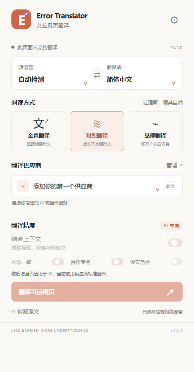
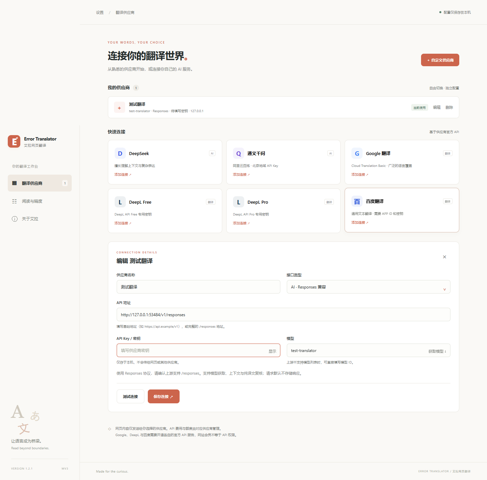

# Error Translator · 艾拉网页翻译

[](https://github.com/sudoriaa/ErrorTranslator/actions/workflows/ci.yml)
[](LICENSE)


使用自己选择的 AI 或官方翻译 API 阅读网页。支持全页翻译、原文对照与悬停翻译，保留页面结构，可随时恢复原文。

Chrome Manifest V3 扩展，当前版本 **1.2.1**。无需运行服务器，直接加载 `extension/` 即可使用；API 服务及费用由用户自行配置。

[安装](#安装) · [配置指南](docs/CONFIGURATION.md) · [开发说明](docs/DEVELOPMENT.md) · [隐私说明](PRIVACY.md) · [变更记录](CHANGELOG.md)

## 界面预览

以下截图由本地模拟供应商生成，展示菜单和设置页。





## 安装

需要 **Chrome 120 或更新版本**。其他 Chromium 浏览器可尝试加载，本项目的自动化测试使用 Chromium；Firefox 不在当前支持范围内。当前通过源码安装，尚未发布 Chrome 商店版本。

1. 下载仓库：点击 GitHub 的 **Code → Download ZIP** 并解压，或执行：

   ```sh
   git clone https://github.com/sudoriaa/ErrorTranslator.git
   ```

2. 打开 `chrome://extensions/`，开启右上角「开发者模式」。
3. 点击「加载已解压的扩展程序」，选择仓库中的 **`extension/` 文件夹**，该目录直接包含 `manifest.json`。
4. 在浏览器工具栏固定「Error Translator - 艾拉网页翻译」，打开扩展设置。
5. 选择供应商预设，填写自己的 API Key 和模型（百度还需 APP ID），保存时授权访问 API 地址。
6. 打开普通网页，点击扩展图标，选择目标语言与模式，再点击「翻译当前网页」。

安装源码无需 Node.js，也无需执行构建命令。如果使用 `npm run build` 生成的扩展 ZIP，解压后选择直接包含 `manifest.json` 的目录。访问本地 HTML 时，请在扩展详情中开启「允许访问文件网址」。

## 功能

| 功能 | 说明 |
| --- | --- |
| 全页翻译 | 替换可见文本，保留链接与事件；支持恢复原文 |
| 原文对照 | 根据空间在原文右侧或下方显示译文，隔离译文样式 |
| 悬停翻译 | 预先翻译页面，移入文本时显示译文，移开 2 秒后恢复 |
| 多供应商 | 同一厂商可添加多个连接，自定义名称、地址、密钥和模型 |
| AI 协议 | 支持 Chat Completions / Responses，获取上游模型列表 |
| 翻译精度 | 可配置上下文、术语表、保留专名、翻译风格及额外译文复核 |
| 纯译文校验 | 校验 JSON、段落编号与明显独白，异常输出最多纠正一次 |
| 动态内容 | 支持新增与变更文本、开放 Shadow DOM、同源 iframe |
| 请求调度 | 自定义并发、批量大小、超时及发起间隔；支持停止与内存缓存 |
| 配置备份 | 导入、导出不含 API Key 和 APP ID 的 JSON 配置 |

支持 20 种常用语言；实际语言方向取决于供应商。上下文、术语、保留专名、风格及复核功能仅适用于 AI 连接。开启复核会增加请求、耗时与上游费用。

## 支持的供应商

| 供应商 | 需要配置 |
| --- | --- |
| DeepSeek | API Key、当前可用模型 |
| 通义千问 | 匹配地域的百炼 API Key、模型；内置北京地域地址 |
| Google 翻译 | Cloud Translation Basic API Key |
| DeepL Free / Pro | 对应的 DeepL API 密钥 |
| 百度翻译 | 通用文本翻译 APP ID 和密钥 |
| 自定义 AI | Chat Completions / Responses 兼容地址、密钥、模型 |
| 本地模型 | 兼容协议的 localhost / 127.0.0.1 地址与模型，可不填密钥 |

扩展不附带任何密钥或免费翻译额度。供应商接口、认证、语言映射、Responses 配置与官方文档见 [配置指南](docs/CONFIGURATION.md)。

默认请求设置为 **5 并发、每批最多 16 段、120 秒超时、350 毫秒发起间隔**。供应商限流时可降低并发或增加间隔；百度逐段串行请求。修改后保存阅读偏好，下次请求生效。

## 数据与权限

常驻权限为 `storage`、`activeTab` 和 `scripting`；供应商 API 源在用户操作时单独授权。密钥保存于 `chrome.storage.local`，不进行 Chrome 同步。扩展无遥测、统计上报或项目代理服务器。

网页文本直接发送给所选供应商，启用 AI 上下文时还会发送标题与相邻文本。悬停模式也会提前发送页面文本。缓存仅保存在后台内存中，最多 800 条。配置导出不含凭据，但仍包含地址、模型、术语表等设置。

详细的数据流、权限和删除方式见 [隐私说明](PRIVACY.md)。

## 限制与常见问题

- **页面无法翻译**：`chrome://`、Chrome 网上应用店及内置 PDF 阅读器受浏览器限制。普通页面上安装或更新扩展后，可先刷新网页。
- **代码和输入框未翻译**：扩展主动跳过代码区域、表单、可编辑区域、隐藏内容和声明不翻译的区域。
- **图片或 iframe 未翻译**：暂不支持图片 / Canvas 文字、封闭 Shadow DOM 或跨域 iframe。
- **对照译文被裁切**：固定高度容器、窄标签和虚拟列表可能限制空间，可切换全页或悬停模式。
- **连接失败**：检查 API 地址、权限、模型、密钥和额度；Free / Pro、不同地域的地址与密钥需匹配。HTTP 401 通常表示凭据无效，429 表示限流。
- **AI 返回讲解或格式错误**：扩展校验并尝试纠正，仍不合格时保留原文并提示失败。可切换模型；本地校验不能保证任意模型的语义准确性。

报告问题请使用 [GitHub Issues](https://github.com/sudoriaa/ErrorTranslator/issues)，附版本、浏览器、翻译模式及脱敏复现步骤。

## 开发与验证

需要 Node.js **20.3 或更新版本**，建议使用 Node.js 22。

```sh
npm ci
npx playwright install chromium
npm run check
npm test
npm run test:browser
npm run build
```

构建输出 `dist/error-translator/` 与 `dist/error-translator-1.2.1.zip`；ZIP 包含扩展、README、MIT 许可证和隐私说明。

验证包含扩展资源校验、36 个接口 / 调度 / 译文校验单元测试、Chat Completions 与 Responses 的真实扩展浏览器测试，以及布局回归。浏览器测试使用本地模拟服务，无需真实 API Key，不消耗翻译额度。CI 在 Windows 上执行上述检查并保存构建 ZIP。

项目结构、逐项测试说明和可选快照回归见 [开发说明](docs/DEVELOPMENT.md)。

## 贡献与许可证

提交改进前请阅读 [贡献指南](CONTRIBUTING.md)。安全问题按 [安全说明](SECURITY.md) 报告。

本项目采用 [MIT 许可证](LICENSE)。扩展图标为本项目的原创几何图形。API 服务的使用和收费条款由各供应商管理。
